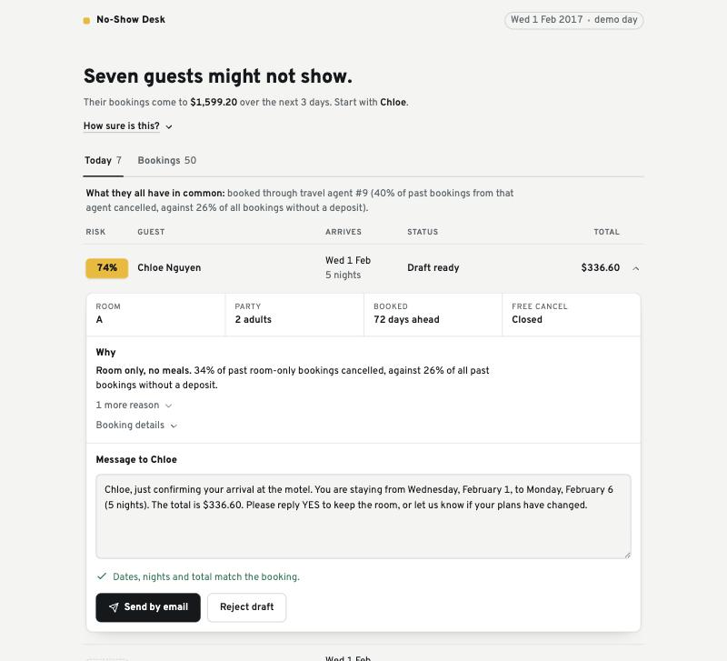
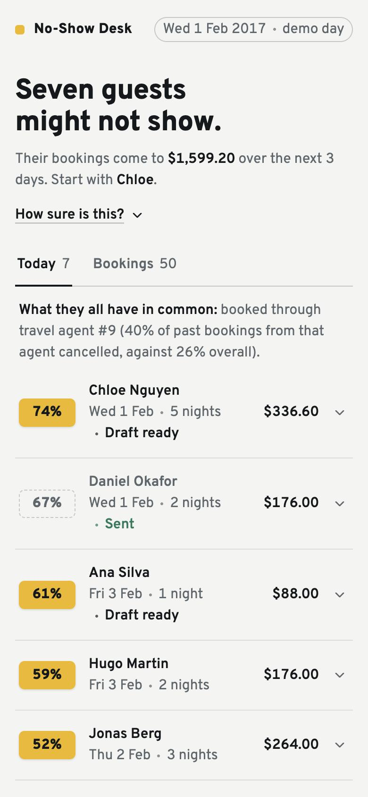
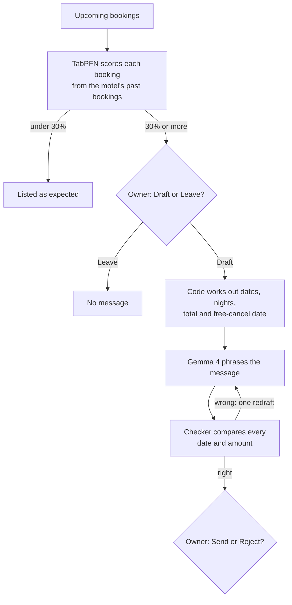

<div align="center">

# No-Show Desk

**Find out which guests won't turn up, days before they don't.**

A morning assistant for small motels and B&Bs. It flags the guests most likely to cancel or not show,<br>
says why in plain words, and drafts a short "are you still coming?" message for the owner to send.

[](LICENSE)




</div>

## Why

A small motel loses a night's income every time a guest silently doesn't arrive. Many of those cancellations can be heard about earlier, if someone asks. No-Show Desk picks who to ask each morning, so the owner spends a minute on it, and a room that would have stood empty can be offered to someone else.

## How a morning works

<table>
<tr>
<td width="62%" valign="top">

1. **08:00, a Telegram message.** *"7 guests arriving in the next 3 days might not show: $1,599.20 of bookings. Start with Chloe Nguyen (74%), Daniel Okafor (67%) and Ana Silva (61%), plus 4 more."*
2. **One page, guests ranked by risk.** Each row opens into the booking and the reasons, worked out from the motel's own past bookings: *"Room only, no meals. 34% of past room-only bookings cancelled, against 26% of all past guests."*
3. **Draft or Leave.** Draft writes a short message on this computer. Leave means no message.
4. **Send or Reject.** Every date and amount in the draft has already been checked against the booking. The owner's own edits are checked again before anything goes, and Leave or Reject can be undone for a few seconds.
5. **Bookings.** The next two weeks of arrivals, searchable, with where each one stands.

Nothing is sent without the owner. In this demo nothing leaves the computer: Send is marked *demo: not delivered*.

</td>
<td width="38%" valign="top">

</td>
</tr>
</table>

## How it works



**Code computes, the model phrases.** The model never works out a date or a price; it is handed them. A plain-Python checker then reads every date, night count and amount in the draft and compares them with the booking. One redraft is allowed; after that the owner sees exactly what's wrong.

| Part | What it does | Where |
|---|---|---|
| Risk | TabPFN scores each upcoming booking from about 3,000 past ones | `noshow/desk.py` |
| Reasons | Cancel rates of similar past guests (lead time, agent, channel, meal plan, history) | `noshow/reasons.py` |
| Facts | Nights, total, and the free-cancel date (left out once it has passed) | `noshow/facts.py` |
| Words | Gemma 4 E2B through Ollama, or in the browser on WebGPU | `noshow/draft.py`, `spike/` |
| Check | Every date and amount in a draft, plus leftover placeholders | `noshow/check.py` |
| Flow | A LangGraph run per guest that pauses twice for the owner | `noshow/graph.py` |
| Owner page | FastAPI and one HTML page, no build step | `noshow/app.py`, `noshow/page.html` |
| Morning summary | Telegram message at 08:00, only to the owner's user id | `noshow/bot.py` |

## Measured

On real past bookings, with the outcome hidden until scoring. Every number comes from a script in `scripts/` and is written to `results/`.

| Question | Result | n | File |
|---|---|---|---|
| Of guests flagged at 30% or more, how many really cancelled? | **53%**, against 29% of all guests | 210 flags over 30 mornings | [thresholds.md](results/thresholds.md) |
| How many of all cancellations did the flags catch? | **111 of 172**; picking the same number at random: 64 | 600 guests | [thresholds.md](results/thresholds.md) |
| Ranking with a motel-sized history | TabPFN ahead of gradient boosting at 300, 1,000 and 3,000 past bookings (0.766 vs 0.702 ROC-AUC at 1,000) | 3 histories per size | [small_history.md](results/small_history.md) |
| Wrong facts when the model works out dates itself | **13 of 100** drafts | 50 bookings × 2 | [drafts.md](results/drafts.md) |
| Wrong facts when code hands it the facts | **0 of 100**, every draft also read by hand | 50 bookings × 2 | [drafts_reconfirm.md](results/drafts_reconfirm.md) |
| Gemma in the browser (WebGPU) | **0 of 20** wrong facts; 2.9 s per draft, against about 31 s through Ollama on the same Mac | 20 drafts | [drafts_browser_spike.md](results/drafts_browser_spike.md) |

The automatic checker missed things on first contact; it was fixed and rescored against the same stored drafts, and both stories are written up in the result files.

## Quick start

Needs Python 3.12, [Ollama](https://ollama.com) and about 6 GB of free disk. Tested on an 8 GB M2 Mac.

```bash
python3.12 -m venv .venv && .venv/bin/pip install -r requirements.txt
ollama pull gemma4:e2b-it-qat          # 4.3 GB, writes the messages
cp .env.example .env                   # add a TabPFN key; Telegram is optional
```

Put `hotels.csv` from the [Hotel booking demand](https://www.kaggle.com/datasets/jessemostipak/hotel-booking-demand) dataset at `data/raw/hotels.csv`, then:

```bash
.venv/bin/python -m pytest -q          # 49 tests
.venv/bin/python -m noshow.app         # http://localhost:8000, plus the Telegram bot and the 08:00 summary
```

<details>
<summary><b>Run Gemma in the browser instead</b></summary>

Download `gemma-4-E2B-it-web.litertlm` (2.0 GB) from [litert-community/gemma-4-E2B-it-litert-lm](https://huggingface.co/litert-community/gemma-4-E2B-it-litert-lm) into `data/models/`, unload Ollama's model, then:

```bash
.venv/bin/python -m spike.server       # open http://localhost:8001 in a browser with WebGPU
```

The page loads the model onto the graphics chip (about 10 s from disk), drafts 20 messages and sends each one to the same checker.
</details>

<details>
<summary><b>Reproduce the numbers</b></summary>

```bash
.venv/bin/python scripts/data_card.py          # what the data is, and which columns give the answer away
.venv/bin/python scripts/eval_risk.py          # risk models on 2017 bookings
.venv/bin/python scripts/eval_small_history.py # motel-sized histories
.venv/bin/python scripts/eval_thresholds.py    # 30 mornings: the 30% line against top 5 and random
.venv/bin/python scripts/eval_drafts.py 50 2   # model works out the facts, or code hands them over
```

The TabPFN scripts need the API key; the draft script needs Ollama.
</details>

## Project layout

```
noshow/        the app: risk, reasons, facts, drafting, checker, graph, page, Telegram bot
tests/         49 tests for the logic (facts, checker, the two pauses, edits, double sends)
scripts/       the measurements behind every number
results/       their output, including every stored draft
spike/         Gemma 4 in the browser (LiteRT-LM on WebGPU)
docs/images/   screenshots
```

## Limits

- **Demo data.** Real bookings from two Portuguese hotels (2015–17), not a motel, so the desk lives on a fixed day: 1 Feb 2017, the earliest of the 30 test mornings with the average number of flags. Guest names and contacts are made up, and prices are shown in dollars.
- **Scoring leaves the computer.** TabPFN runs through Prior Labs' API, so booking details (never names; the data has none) are sent for scoring under its free non-commercial licence. A paid version needs Prior Labs' commercial terms or TabPFN's open weights run locally. Gemma already runs locally.
- **Reasons explain the group, not the order.** Guests who share a profile show the same reasons; the order within them is TabPFN weighing everything together.
- **The morning link opens on the desk computer.** The page listens on `localhost`.
- **Sending is a mock.** Approved messages go to `data/outbox.jsonl`.

## Credits

- Data: *Hotel booking demand datasets*, Antonio, Almeida & Nunes, *Data in Brief* 22 (2019), CC BY 4.0.
- Risk: [TabPFN](https://priorlabs.ai) by Prior Labs. Words: [Gemma](https://ai.google.dev/gemma) by Google, through [Ollama](https://ollama.com) and [LiteRT-LM](https://github.com/google-ai-edge/LiteRT-LM).
- Font: [Overpass](https://github.com/RedHatOfficial/Overpass), SIL Open Font Licence (`noshow/fonts/OFL.txt`).

## License

[MIT](LICENSE) © 2026 Dhruv Patel
